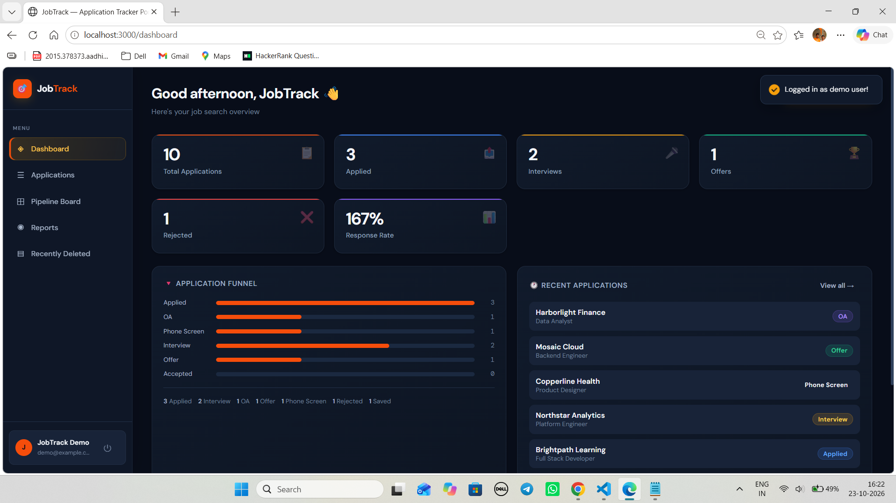

# JobTrack — Job Application Tracker Portal

> A full-stack MERN application to track job applications, interview stages, and get analytics on your job hunt.


---

## Problem Statement

Students and working professionals often apply for multiple jobs across platforms such as LinkedIn, Indeed, Naukri, and company career portals. Managing these applications manually across different platforms can become difficult and time-consuming.

Without a centralized job application tracking system:

- **Missed applications:** Applicants may forget where they applied or lose track of application statuses.
- **Missed interviews:** Interview schedules and follow-up dates can be overlooked.
- **Missed deadlines:** Offer acceptance deadlines and important recruitment timelines may pass unnoticed.
- **Lack of insights:** Applicants may struggle to measure response rates, track hiring progress, and identify which job-search channels are most effective.

JobTrack addresses these challenges by providing a centralized platform to organize job applications, track recruitment stages, manage important details, and monitor job-search progress through a dashboard and reports.

**JobTrack** solves this with a structured, beautiful, and data-driven portal.

---

## Features

| Feature                   | Description |
|--------------------------|-------------------------------------------------------------|
| **Authentication**       | JWT-based registration and login with bcrypt password hashing |
| **Password Reset**       | Recover account access through the password-reset flow |
| **Add Applications**     | Track company, role, location, salary, source, and application URL |
| **Stage Tracking**       | Track progress through Saved → Applied → OA → Interview → Offer → Accepted |
| **Priority Flag**        | Mark important applications for easy identification |
| **Search & Filter**      | Search by company or role and filter applications by stage or source |
| **Dashboard**            | View statistics cards, recent applications, response rate, and source breakdown |
| **Kanban Board**         | Visual application pipeline with quick stage updates |
| **Reports & Analytics**  | Visualize application data with bar charts, pie charts, and weekly trends using Recharts |
| **Notes Management**     | Maintain application notes and additional job-search details |
| **Document Attachments** | Organize application-related documents, including PDFs |
| **Recently Deleted**     | Access deleted applications and restore them where supported |
| **Responsive Design**    | Use the application across mobile, tablet, and desktop screens |
| **Dark Theme**           | Dark interface designed for a consistent, modern user experience |

> **Note:** Keep only features that are implemented and working in your current codebase. Confirm that JWT authentication, bcrypt hashing, Recharts visualizations, and the listed application stages match your actual implementation.

---

## Tech Stack

**Frontend**

- React.js 18 (CRA)
- React Router v6
- Axios (API calls with JWT interceptors)
- Recharts (analytics charts)
- React Hot Toast (notifications)
- Custom CSS (dark editorial theme, no framework dependency)

**Backend**

- Node.js + Express.js
- Mongoose (MongoDB ODM)
- bcryptjs (password hashing)
- jsonwebtoken (JWT auth)
- Morgan (request logging)

**Database**

- MongoDB (local or Atlas)

---

## Folder Structure

```
Job-Application-Tracker-Portal/
│
├── client/                      # React frontend
│   ├── public/
│   │   └── index.html
│   ├── src/
│   │   ├── components/          # Reusable components
│   │   │   ├── Layout.js        # App shell + sidebar
│   │   │   └── ApplicationModal.js # Add/Edit modal
│   │   ├── context/
│   │   │   └── AuthContext.js   # Global auth state
│   │   ├── pages/
│   │   │   ├── LoginPage.js
|   |   |   ├── ForgetPassword.js
|   |   |   ├── ResetPassword.js
|   |   |   ├── TrashPage.js
│   │   │   ├── RegisterPage.js
│   │   │   ├── DashboardPage.js
│   │   │   ├── ApplicationsPage.js
│   │   │   ├── KanbanPage.js
│   │   │   └── ReportsPage.js
│   │   ├── utils/
│   │   │   └── api.js           # Axios instance
│   │   ├── App.js               # Root + routes
│   │   └── index.css            # Global styles
│   └── package.json
│
├── server/                      # Express backend
│   ├── config/
│   │   └── db.js                # MongoDB connection
│   ├── controllers/
│   │   ├── authController.js    # Register, login, getMe
│   │   ├── applicationController.js  # Full CRUD
│   │   └── dashboardController.js    # Analytics
│   ├── middleware/
│   │   └── authMiddleware.js    # JWT protect middleware
│   ├── models/
│   │   ├── User.js              # User schema
│   │   └── JobApplication.js   # Application schema
│   ├── routes/
│   │   ├── authRoutes.js
│   │   ├── applicationRoutes.js
│   │   └── dashboardRoutes.js
│   ├── .env.example
│   ├── index.js                 # Server entry point
│   └── package.json
│
├── docs/                        # Screenshots, diagrams
├── .gitignore
└── README.md
```

---

## API Endpoints

### Auth

| Method | Endpoint             | Description                  |
| ------ | -------------------- | ---------------------------- |
| POST   | `/api/auth/register` | Create new user              |
| POST   | `/api/auth/login`    | Login + get JWT              |
| GET    | `/api/auth/me`       | Get current user (protected) |

### Applications (all protected)

| Method | Endpoint                      | Description             |
| ------ | ----------------------------- | ----------------------- |
| GET    | `/api/applications`           | List all (with filters) |
| POST   | `/api/applications`           | Create new application  |
| GET    | `/api/applications/:id`       | Get single application  |
| PUT    | `/api/applications/:id`       | Full update             |
| DELETE | `/api/applications/:id`       | Delete                  |
| PATCH  | `/api/applications/:id/stage` | Update stage only       |

### Dashboard

| Method | Endpoint                 | Description    |
| ------ | ------------------------ | -------------- |
| GET    | `/api/dashboard/summary` | Analytics data |

---

## Installation & Setup

### Prerequisites

- Node.js 18+
- MongoDB (local) or MongoDB Atlas account

### 1. Clone the repository

```bash
git clone https://github.com/YOUR_USERNAME/Job-Application-Tracker-Portal.git
cd Job-Application-Tracker-Portal
```

### 2. Backend setup

```bash
cd server
npm install
cp .env.example .env
# Edit .env with your MongoDB URI and a secret JWT key
npm run dev
```

### 3. Frontend setup

```bash
cd client
npm install
npm start
```

### 4. Environment variables (`server/.env`)

```
PORT=5000
MONGO_URI=mongodb://localhost:27017/job_tracker
JWT_SECRET=your_super_secret_key_here
JWT_EXPIRES_IN=7d
NODE_ENV=development
```

### 5. Access the app

- Frontend: http://localhost:3000
- Backend API: http://localhost:5000

---

## 📸 Project Screenshots

### Login Page


### Register Page


### Dashboard


### Kanban Dashboard


### Reports and Analytics


### Recently Deleted


### MongoDB Collections


## 🎯 Learning Outcomes

By building the JobTrack — Job Application Tracker Portal, I gained practical experience in:

- **Full-Stack Development:** Understanding MERN architecture and separation of concerns between frontend, backend, and database.
- **Authentication & Security:** Implementing JWT-based authentication, password hashing with bcryptjs, and protected API routes.
- **REST API Development:** Designing RESTful endpoints using Node.js and Express.js for application CRUD operations.
- **Database Modeling:** Creating Mongoose schemas, managing document relationships, and working with MongoDB.
- **State Management:** Using React Context API to manage global authentication state.
- **API Integration:** Configuring Axios interceptors to attach authentication tokens to API requests.
- **Routing:** Implementing protected and public routes with React Router v6.
- **Reusable Components:** Building reusable React components, modals, layouts, and forms.
- **Data Visualization:** Creating interactive charts and reports using Recharts.
- **Database Analytics:** Using MongoDB aggregation pipelines to calculate dashboard statistics and application trends.
- **Workflow Management:** Modeling job application stages and implementing Kanban-based tracking.
- **Debugging & Testing:** Validating API behavior, handling errors, and testing application workflows.
---

## Author

Navnit Bihari

GitHub:
https://github.com/Biharinavnit

LinkedIn:
https: //www.linkedin.com/in/navnit-bihari-9a894b298/

---

⭐ If you found this project useful, please give it a star on GitHub.
